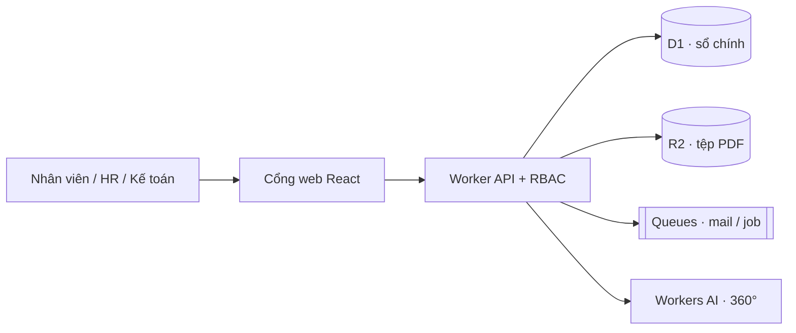
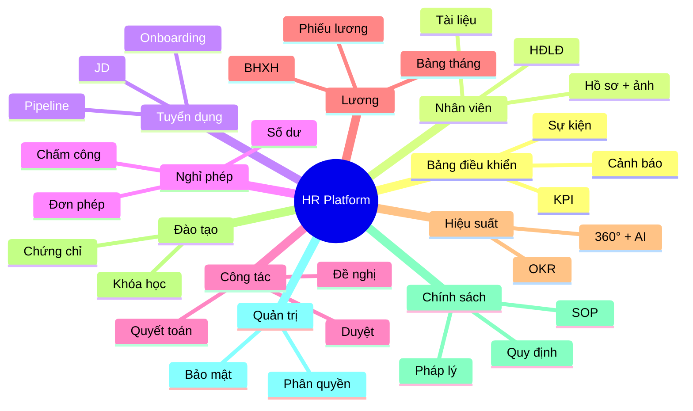
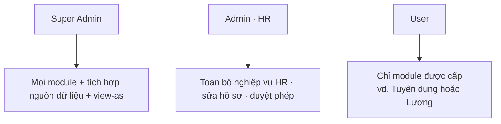
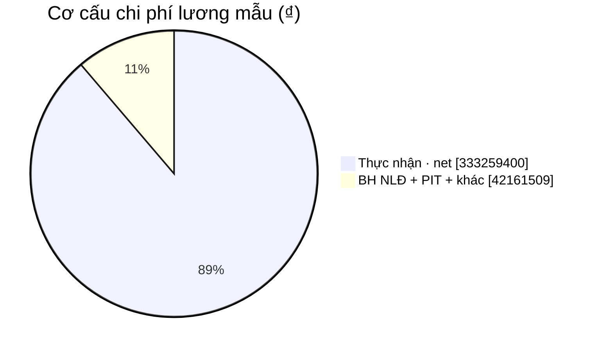
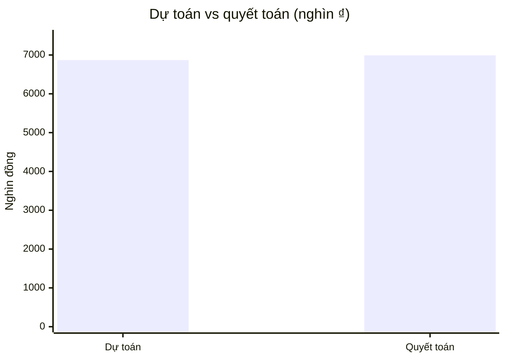
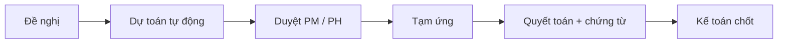
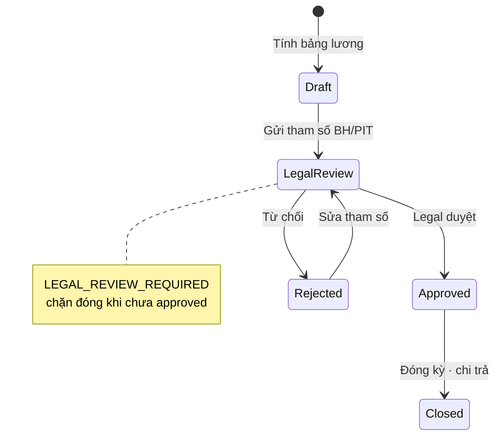
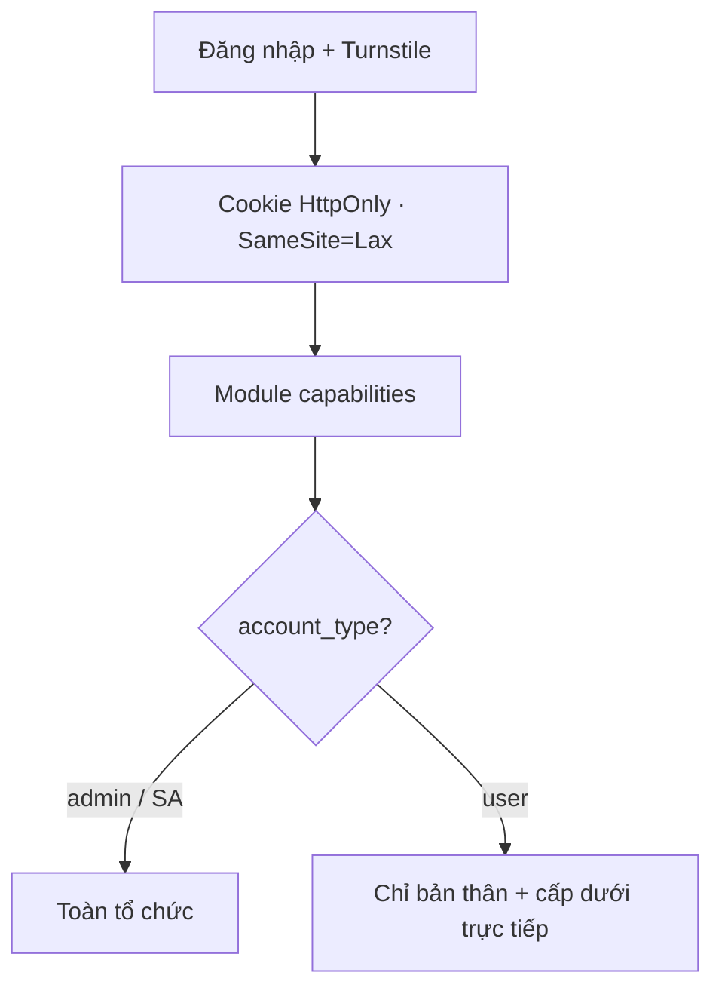
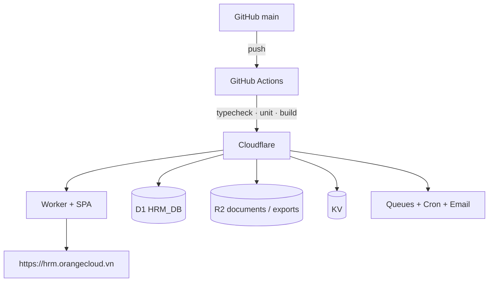

# HR Management Platform

<p align="center">
  
</p>

<p align="center">
  <strong>Cổng nhân sự nội bộ cho doanh nghiệp Việt Nam</strong><br/>
  Nghỉ phép · Công tác · Lương · Tuyển dụng · OKR · Đào tạo — một nền tảng
</p>

<p align="center">
  <a href="https://hrm.orangecloud.vn"></a>
  <a href="https://github.com/sycu8/hr-management-platform/actions/workflows/deploy.yml"></a>
  <a href="https://github.com/sycu8/hr-management-platform/actions/workflows/ci.yml"></a>
</p>

<p align="center">
  
  
  
  
  
  
</p>

---

## Bản đồ nhanh (30 giây)



| Bạn cần… | Đi tới |
| --- | --- |
| Dùng thử | [hrm.orangecloud.vn](https://hrm.orangecloud.vn) |
| Hiểu giá trị kinh doanh | [docs/FOR_EXECUTIVES.md](docs/FOR_EXECUTIVES.md) |
| Kiến trúc kỹ thuật | [docs/ARCHITECTURE.md](docs/ARCHITECTURE.md) |
| Vận hành / secrets | [docs/OPERATIONS.md](docs/OPERATIONS.md) |
| Inventory QA | [docs/QA_INVENTORY.md](docs/QA_INVENTORY.md) |

---

## 10 module nghiệp vụ



| Module | Việc lãnh đạo thấy được |
| --- | --- |
| **Bảng điều khiển** | Headcount, cảnh báo, sự kiện sắp tới |
| **Nhân viên** | Hồ sơ, HĐ, lịch sử, tài liệu, ảnh thẻ |
| **Tuyển dụng** | JD, pipeline ứng viên, onboarding checklist |
| **Nghỉ phép** | Đơn phép, số dư, chấm công, lịch team |
| **Công tác** | Đề nghị → duyệt → tạm ứng → quyết toán |
| **Lương** | Bảng tháng, CSV/Excel, phụ cấp, BH |
| **Hiệu suất** | OKR theo quý/năm, 360° radar + AI |
| **Đào tạo** | Catalog, tiến độ, chứng chỉ, career path |
| **Chính sách** | Quy định / SOP / pháp lý + OCR upload |
| **Quản trị** | Phân quyền, bảo mật, xuất dữ liệu |

---

## Ai dùng hệ thống?



| Loại | Ai dùng | Quyền chính |
| --- | --- | --- |
| **Super Admin** | IT / chủ hệ thống | Toàn quyền + view-as + tích hợp |
| **Admin (HR)** | Nhân sự | Quản lý dữ liệu, user, duyệt (không cấu hình nguồn) |
| **User** | Nhân viên theo chức năng | Module được cấp (read/write theo level) |

**Demo** (chỉ môi trường thử — **đổi mật khẩu trên production**):

| Vai trò | Email | Mật khẩu demo |
| --- | --- | --- |
| Super Admin | `super@orangecloud.vn` | `SuperAdmin!2026` |
| Admin HR | `admin@orangecloud.vn` | `Admin!2026` |
| User tuyển dụng | `user.tuyendung@orangecloud.vn` | `User!2026` |
| User lương | `user.luong@orangecloud.vn` | `User!2026` |

---

## Dữ liệu mẫu dễ đọc (golden / khóa bằng test)

Số liệu dưới đây lấy từ seed demo tháng **09/2026** và chuyến công tác mẫu — được **khóa bằng Vitest** để tránh lệch công thức.

### Lương tháng 09/2026 (nhóm gốc)



| Chỉ số | Giá trị | Ý nghĩa |
| --- | --- | --- |
| **Gross** | **375.420.909 ₫** | Tổng thu nhập trước khấu trừ |
| **Net** | **333.259.400 ₫** | Thực nhận nhân viên |
| Chênh lệch | ~42,2 triệu ₫ | BH + PIT (và phần còn lại trong snapshot) |
| Headcount mẫu | 31 | Cohort golden e1–e12 mở rộng |

Ví dụ phiếu cá nhân (đã khóa test; chính sách từ 01/07/2026):

| NV | Ngày công | Gross | BH NLĐ | PIT | Net |
| --- | ---: | ---: | ---: | ---: | ---: |
| e1 | 22 | 24.730.000 | 1.890.000 | 20.500 | 22.819.500 |
| e4 | 21 | 64.184.545 | 4.725.000 | 2.665.909 | 56.793.636 |
| e5 | 22 | 86.530.000 | 5.657.000 | 6.948.600 | 73.924.400 |

### Công tác phí — chuyến `CT-2026-0001`



| Bước | Số tiền | Ghi chú |
| --- | ---: | --- |
| Dự toán | **6.870.000 ₫** | Theo vùng / cấp bậc / chính sách |
| Quyết toán | **6.990.000 ₫** | Sau chứng từ thực tế (+120.000 ₫) |



### Lương — cổng pháp lý



---

## Phân quyền & bảo mật (tóm tắt)



- **RBAC trên server** — sidebar chỉ ẩn UI; API mới là cổng thật.  
- **User** không thấy directory / phiếu lương / 360 của cả công ty.  
- **Turnstile** test keys chỉ hợp lệ khi hostname = `localhost` / `127.0.0.1`.  
- Chi tiết vận hành: [docs/OPERATIONS.md](docs/OPERATIONS.md).

---

## Kiến trúc kỹ thuật



| Tầng | Công nghệ | Vai trò |
| --- | --- | --- |
| UI | React 19 + Vite | SPA tiếng Việt |
| API | Hono trên Workers | RBAC, nghiệp vụ, Turnstile |
| DB | D1 | Hồ sơ, phép, lương, OKR… |
| File | R2 | Ảnh NV, PDF chính sách, export |
| AI | Workers AI + AI Gateway | Phân tích 360° |
| CI/CD | GitHub Actions | Test → migrate → deploy |

---

## Quick start (kỹ thuật)

```bash
npm install
cp .dev.vars.example .dev.vars   # Turnstile always-pass keys · localhost only
npm run db:migrate:local
npm run db:seed:local:all
npm run dev
```

| Script | Mục đích |
| --- | --- |
| `npm run dev` | SPA + Worker local |
| `npm run qa:local` | typecheck + unit + e2e |
| `npm run test:unit` | Golden travel / payroll / scope / Turnstile |
| `npm run test:e2e` | Playwright inventory |
| `npm run deploy` | Build + `wrangler deploy` (local operator) |

Production: push `main` → workflow **Deploy Cloudflare**  
Secrets: [docs/GITHUB_SECRETS.md](docs/GITHUB_SECRETS.md)

> Deploy **không** tự ghi đè mật khẩu production bằng seed demo. Seed auth remote chỉ chạy chủ động: `npm run db:seed:auth:remote`.

---

## Tài liệu

| Tài liệu | Nội dung |
| --- | --- |
| [FOR_EXECUTIVES.md](docs/FOR_EXECUTIVES.md) | Tóm tắt CEO / CHRO / CFO |
| [ARCHITECTURE.md](docs/ARCHITECTURE.md) | Kiến trúc đầy đủ |
| [OPERATIONS.md](docs/OPERATIONS.md) | Secrets, bảo mật, vận hành |
| [LEGAL_PARAMETERS.md](docs/LEGAL_PARAMETERS.md) | Tham số BHXH / PIT |
| [QA_INVENTORY.md](docs/QA_INVENTORY.md) | Inventory + bug log QA |
| [ACCEPTANCE_BASELINE.md](docs/ACCEPTANCE_BASELINE.md) | Tiêu chí chấp nhận |

---

<p align="center">
  <sub>Orange Cloud · HR Management Platform · <a href="https://hrm.orangecloud.vn">hrm.orangecloud.vn</a></sub>
</p>
